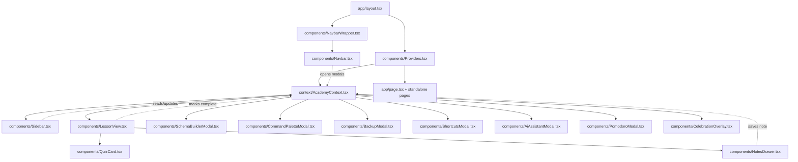

# 🏛️ Payload Academy — Technical Architecture & Agent Developer Guide

> **Welcome Agent / Developer!** This document contains the complete structural blueprint, component relations, data pipelines, state management lifecycle, and extension instructions for the **Payload Academy** Next.js application. Any AI agent or human engineer can use this guide to maintain, refactor, or expand the codebase without breaking patterns.

---

## 1. 📋 System Overview & Tech Stack

| Layer | Technology | Purpose |
|---|---|---|
| **Framework** | Next.js (App Router, Turbopack) | Server & Client Components, routing, build optimization |
| **UI Library** | React 19 / TypeScript 5 | Reactive component model, hooks, strict schema types |
| **Styling** | Vanilla CSS + Design Tokens (`app/globals.css`) | Curated palette, dark/light modes, Mac window chrome, print media |
| **State Layer** | React Context (`context/AcademyContext.tsx`) | Global lesson progress, active modals, theme, role filters, study notes |
| **Storage** | Browser `localStorage` | Client-side persistence for completed lessons, notes, and preferences |

---

## 2. 🌲 Directory Tree & File Relations Map

```
payload-academy/
├── app/
│   ├── globals.css              # Master stylesheet (tokens, theme variables, print rules, animations)
│   ├── layout.tsx               # Root Next.js layout (Google Fonts, Navbar, AcademyProvider, PWA meta)
│   ├── page.tsx                 # Course view (Sidebar + LessonView)
│   ├── dashboard/page.tsx       # Standalone Learning Analytics & Progress Dashboard
│   ├── query-simulator/page.tsx # Standalone Query Simulator page (interactive WHERE filter builder)
│   ├── glossary/page.tsx        # Standalone Glossary page (alphabetical filtering & code examples)
│   ├── changelog/page.tsx       # Standalone Changelog & Migration Guide page (v3.0 to v3.x timeline)
│   ├── final-exam/page.tsx      # Standalone Final Exam page (50-question mastery assessment)
│   └── certificate/page.tsx     # Standalone Certificate generator (HTML5 Canvas & PDF verification)
├── components/
│   ├── Providers.tsx            # Wraps app in AcademyProvider + mounts all global modals/overlays
│   ├── NavbarWrapper.tsx        # Thin client wrapper that mounts the global Navbar
│   ├── Navbar.tsx               # Global top navigation bar with route links, streak badge, AI & Focus tools
│   ├── Sidebar.tsx              # Lesson drawer, search, role filters, standalone hub & community links
│   ├── LessonView.tsx           # Active lesson renderer, TOC, print/PDF, bookmark, feedback, related lessons
│   ├── QuizCard.tsx             # Interactive per-lesson quiz card with instant feedback and explanation
│   ├── NotesDrawer.tsx          # Collapsible study notepad auto-saved to localStorage
│   ├── SchemaBuilderModal.tsx   # Visual Collection & Field builder with live TypeScript output
│   ├── CommandPaletteModal.tsx  # Spotlight search modal (Ctrl+K / /) with keyboard navigation
│   ├── ShortcutsModal.tsx       # Keyboard shortcuts cheat sheet (? key)
│   ├── CelebrationOverlay.tsx   # Canvas confetti celebration overlay upon module completion
│   ├── AiAssistantModal.tsx     # Interactive Payload 3.x AI Assistant with schema generation & Q&A
│   ├── PomodoroModal.tsx        # Focus / Pomodoro timer with 25m/5m/15m modes and session tracking
│   └── BackupModal.tsx          # Export/Import progress and study notes as JSON backup file
├── context/
│   └── AcademyContext.tsx       # Master React Context & Hook (useAcademy) providing unified state
├── data/
│   ├── types.ts                 # TypeScript interfaces (Lesson, Quiz, Challenge, Role, GlossaryEntry, etc.)
│   ├── lessons.ts               # Complete array of 50 lessons across 10 curriculum modules
│   ├── quizzes.ts               # Keyed dictionary of 50 quiz questions, options, and explanations
│   ├── challenges.ts            # Keyed dictionary of 50 coding challenges and documentation deep links
│   ├── glossary.ts              # Keyed dictionary of Payload 3.x terms, definitions and examples
│   └── changelog.ts             # Keyed releases dataset with breaking changes & migration tips
├── public/
│   ├── manifest.json            # PWA Web App Manifest (standalone display, theme colors)
│   └── favicon.ico              # App favicon
├── ARCHITECTURE.md              # THIS FILE — Master technical & agent integration guide
├── package.json                 # Dependencies and npm scripts
└── tsconfig.json                # TypeScript compiler config and @/* path alias
```

---

## 3. 🔄 Component Hierarchy & State Flow



---

## 4. 📦 Data Schemas (`data/types.ts`)

### `Lesson`
```typescript
export type Role = 'all' | 'frontend' | 'backend' | 'devops';

export interface Lesson {
  id: string;        // Unique identifier (e.g. 'config', 'actions', 'transactions')
  m: string;         // Module name (e.g. 'Core Concepts', 'Security & Logic')
  t: string;         // Lesson Title
  r: Role[];         // Target role filters (['all', 'backend'])
  badge?: 'new';     // Optional badge indicator for newly added advanced lessons
  c: string;         // Rich HTML content including code snippets, tables, callouts
}
```

### `Quiz`
```typescript
export interface Quiz {
  question: string;     // The quiz question prompt
  options: string[];    // Array of 3 selectable answer options
  correct: number;      // 0-indexed index of the correct option
  explanation: string;  // Detailed explanation displayed after answering
}
```

### `Challenge`
```typescript
export interface Challenge {
  docsPath: string;       // Subpath in official documentation (e.g. 'fields/join')
  challengeText: string;  // Actionable hands-on coding task
}
```

---

## 5. ⚡ Global State (`context/AcademyContext.tsx`)

Access any application state anywhere using the `useAcademy()` hook:

```typescript
const {
  currentLessonIndex,    // Number (0 to 49)
  setCurrentLessonIndex, // (index: number) => void
  roleFilter,            // 'all' | 'frontend' | 'backend' | 'devops'
  setRoleFilter,         // (role: Role) => void
  searchQuery,           // String
  setSearchQuery,        // (q: string) => void
  completedLessons,      // Record<string, boolean>
  toggleComplete,        // (lessonId: string) => void
  completedQuizzes,      // Record<string, boolean> (all 50 lesson quizzes)
  recordQuizPass,        // (lessonId: string) => void
  examScore,             // number | null (0 to 100)
  setExamScore,          // (score: number) => void
  canTakeExam,           // boolean (requires 50 lessons completed + 50 quizzes passed, or isAdmin)
  canClaimCertificate,   // boolean (requires examScore >= 80%, or isAdmin)
  isAdmin,               // boolean (admin bypass mode)
  toggleAdmin,           // () => void
  setIsAdmin,            // (val: boolean) => void
  userNotes,             // Record<string, string>
  setNote,               // (lessonId: string, note: string) => void
  bookmarks,             // Record<string, boolean>
  toggleBookmark,        // (lessonId: string) => void
  lessonFeedback,        // Record<string, 'up' | 'down'>
  setFeedback,           // (lessonId: string, val: 'up' | 'down') => void
  theme,                 // 'dark' | 'light'
  toggleTheme,           // () => void
  streak,                // number (daily study streak)
  activeModal,           // ModalType
  setActiveModal,        // (modal: ModalType) => void
} = useAcademy();
```

### 🔒 Progressive Mastery Gating Flow:
1. **Core Curriculum**: Complete all 50 lessons and answer all 50 quick-check quizzes.
2. **Final Exam (`/final-exam`)**: Gated until **all 50 lessons are completed** AND **all 50 quizzes are passed** (or `isAdmin` is active).
3. **Verified Certificate of Mastery (`/certificate`)**: Gated until achieving **80% or higher** (40 / 50 questions) on the Final Exam (or `isAdmin` is active).
4. **👑 Admin Mode Override**:
   - Allows administrators to preview, test, and download certificates and take the final exam without prerequisite progression.
   - Accessible via the Navbar More Tools dropdown (`⋮`), mobile menu, or directly from locked exam/certificate pages.

### `localStorage` Keys:
- `pa-done`: JSON map of completed lesson IDs (`{ [lessonId]: true }`)
- `pa-quizzes`: JSON map of passed lesson quizzes (`{ [lessonId]: true }`)
- `pa-exam-score`: Integer percentage score from latest final exam attempt
- `pa-admin`: String `'true'` or `'false'` for Admin Mode bypass
- `pa-days`: Array of active study dates (`["2025-03-15", ...]`)
- `pa-bookmarks`: JSON map of saved lesson IDs
- `pa-feedback`: JSON map of lesson ratings (`up` / `down`)
- `pa-cur`: Integer index of active lesson
- `pa-role`: Active role filter (`'all'`, `'frontend'`, `'backend'`, `'devops'`)
- `pa-notes`: JSON map of user study notes
- `pa-theme`: Active theme (`'dark'` or `'light'`)

---

## 6. 🛠️ Step-by-Step Extension Guides

### How to Add a New Lesson
1. Open `data/lessons.ts` and append a new lesson object to the `LESSONS` array:
   ```typescript
   {
     id: 'my-new-topic',
     m: 'Advanced',
     t: 'Custom Caching Invalidation',
     r: ['all', 'backend', 'devops'],
     badge: 'new',
     c: `<p class="lead">Lesson content goes here...</p>
         <div class="cb"><div class="fn">example.ts</div><pre><code>...</code></pre></div>`
   }
   ```
2. Open `data/quizzes.ts` and add its knowledge check:
   ```typescript
   'my-new-topic': {
     question: 'Which hook should you use for cache invalidation?',
     options: ['afterChange', 'beforeValidate', 'afterRead'],
     correct: 0,
     explanation: 'afterChange runs immediately after the database write succeeds.'
   }
   ```
3. Open `data/challenges.ts` and add its challenge & docs link:
   ```typescript
   'my-new-topic': {
     docsPath: 'hooks/overview',
     challengeText: 'Implement revalidateTag on publish.'
   }
   ```

### How to Add a New Interactive Modal / Tool
1. Create your component in `components/MyNewModal.tsx`:
   ```tsx
   'use client'
   import React from 'react';
   import { useAcademy } from '@/context/AcademyContext';

   export const MyNewModal: React.FC = () => {
     const { activeModal, setActiveModal } = useAcademy();
     if (activeModal !== 'myNewTool') return null;

     return (
       <div className="modal-backdrop open" onClick={(e) => { if (e.target === e.currentTarget) setActiveModal('none'); }}>
         <div className="modal">
           <div className="modal-head">
             <h2>🚀 My New Interactive Tool</h2>
             <button className="modal-close" onClick={() => setActiveModal('none')}>&times;</button>
           </div>
           <div className="modal-body">
             {/* Your interactive tool UI */}
           </div>
         </div>
       </div>
     );
   };
   ```
2. Update `ModalType` in `context/AcademyContext.tsx`:
   ```typescript
   export type ModalType = 'none' | 'schema' | 'command' | 'backup' | 'shortcuts' | 'ai' | 'pomodoro' | 'myNewTool';
   ```
3. Add a launch button in `components/Navbar.tsx` and register the modal in `components/Providers.tsx`.

---

## 7. 🎨 Design System & HTML Formatting Standards

When writing HTML content within lessons:
- **Code Block with Mac Chrome:**
  ```html
  <div class="cb">
    <div class="fn">src/collections/Posts.ts</div>
    <pre><code>...code...</code></pre>
  </div>
  ```
- **Callouts:**
  - `<div class="tip"><b>Tip Title:</b> Tip description.</div>` (Green)
  - `<div class="warn"><b>Warning:</b> Warning text.</div>` (Red)
  - `<div class="note"><b>Note:</b> Note text.</div>` (Blue)
  - `<div class="info"><b>Info:</b> Info text.</div>` (Purple)
- **Checklist:**
  ```html
  <ul class="checklist">
    <li>Item 1</li>
    <li>Item 2</li>
  </ul>
  ```
- **Numbered Steps:**
  ```html
  <div class="steps">
    <div class="step"><div class="step-n"></div><div class="step-body"><strong>Step Title</strong>Description.</div></div>
  </div>
  ```

---

## 8. 🚀 Development & Build Commands

```bash
# Start Next.js development server
npm run dev

# Compile production bundle & typecheck
npm run build

# Start production server
npm run start
```
